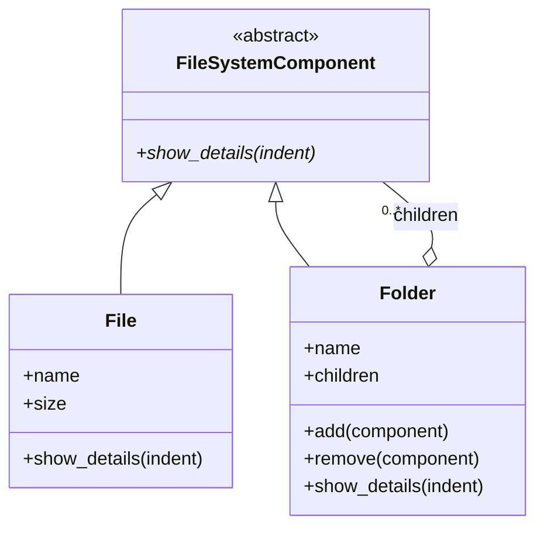

# Composite

A small 2024 example kept for reference; the repository is archived.

In software engineering, the [composite](https://refactoring.guru/design-patterns/composite) pattern is a partitioning design pattern. The composite pattern describes a group of objects that are treated the same way as a single instance of the same type of object. The intent of a composite is to "compose" objects into tree structures to represent part-whole hierarchies. Implementing the composite pattern lets clients treat individual objects and compositions uniformly.



## Installation - the easy (maybe) way

1.  The installation requires [python>3.12](https://www.python.org/downloads/).

2.  **Clone the repository** 

    Clone the repo and move into the project directory:

    ```bash
    git clone https://github.com/Fede-Berga/composite.git
    cd composite
    ```

3. **Run the script**

    Now you can run the Python script:

    ```bash
    python3 main.py
    ```

## Installation - the harder (maybe) way

1. The installation requires [Docker](https://www.docker.com/).

2.  **Clone the repository** 

    Clone the repo and move into the project directory:

    ```bash
    git clone https://github.com/Fede-Berga/composite.git
    cd composite
    ```

3. **Run the following command**

    ```bash
    docker compose up 
    ```
